<div align="center">



<br>


</div>

---

## 🍄 WORLD 1-1: ABOUT ME

```
> NAME     : YOUR NAME
> CLASS    : SOFTWARE ENGINEER
> HOME     : YOUR CITY
> QUEST    : BUILD COOL STUFF, SHIP IT, REPEAT
> STATUS   : READY PLAYER ONE
```

## ⭐ POWER-UPS (TECH STACK)


## 🗺️ WORLD SELECT (PROJECTS)

| WORLD | QUEST | POWER-UPS | STATUS |
|:-----:|-------|-----------|:------:|
| 1-1 | [**Project One**](https://github.com/USERNAME/project-one), short description | Python, FastAPI | 🟢 CLEARED |
| 1-2 | [**Project Two**](https://github.com/USERNAME/project-two), short description | TypeScript, React | 🟡 IN PROGRESS |
| 1-3 | [**Project Three**](https://github.com/USERNAME/project-three), short description | Rust | 🔴 LOCKED |

## 🪙 HIGH SCORES

<div align="center">


</div>

## 🟩 WARP PIPE (CONTACT)

[](mailto:you@example.com)
[](https://linkedin.com/in/USERNAME)
[](https://x.com/USERNAME)

<br>

<div align="center">

</div>
