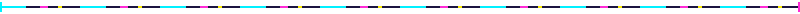

<br>

## // 01 IDENTITY

```text
$ whoami
YOUR NAME :: software engineer

$ cat /etc/mission
build things that ship.

$ uptime
YOUR CITY | online since 20XX
```



## // 02 LOADOUT


## // 03 ACTIVE PROJECTS

| ID | PROJECT | STACK | STATE |
|----|---------|-------|-------|
| 001 | [project-one](https://github.com/USERNAME/project-one), one line on what it does | python, fastapi | `[ ONLINE ]` |
| 002 | [project-two](https://github.com/USERNAME/project-two), one line on what it does | typescript, react | `[ WIP ]` |
| 003 | [project-three](https://github.com/USERNAME/project-three), one line on what it does | rust | `[ OFFLINE ]` |


## // 04 TELEMETRY

<p>


</p>


## // 05 COMMS

[](mailto:you@example.com)
[](https://linkedin.com/in/USERNAME)
[](https://x.com/USERNAME)

<br>


